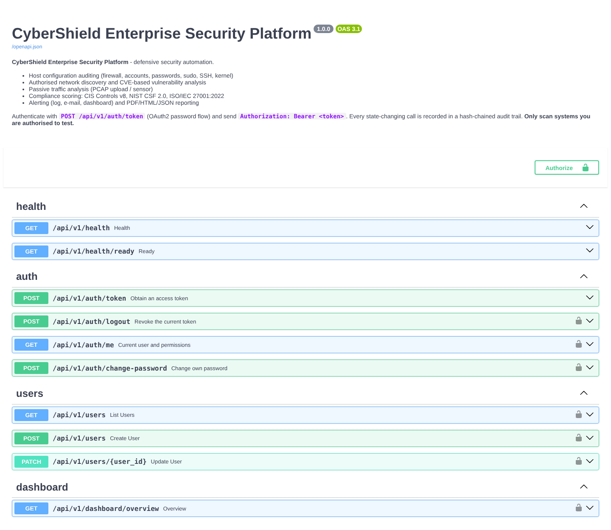

# API Documentation

* Interactive documentation: `http://localhost:8000/docs` (Swagger UI) and `/redoc`
* Machine-readable specification: [`docs/openapi.json`](openapi.json) (OpenAPI 3.1, 35 paths)
* Base path: `/api/v1` · JSON everywhere · UTC ISO-8601 timestamps



## 1. Authentication

OAuth2 password flow returning a signed JWT (HS256, 30 minutes, issuer/audience pinned, `jti` for revocation).

```bash
curl -s -X POST http://localhost:8000/api/v1/auth/token \
  --data-urlencode username=admin --data-urlencode 'password=<password>'
```

```json
{"access_token": "eyJhbGciOiJIUzI1NiIs...", "token_type": "bearer", "expires_in": 1800, "role": "admin"}
```

Send `Authorization: Bearer <token>` on every other call. Tokens are invalidated by `POST /auth/logout`, by a
password change, and immediately when an administrator changes the user's role or deactivates the account.

## 2. Endpoints

| Method | Path | Permission | Description |
|---|---|---|---|
| GET | `/health` | public | Liveness (`{"status":"ok"}`) |
| GET | `/health/ready` | public | Readiness (database reachable) |
| POST | `/auth/token` | public (rate limited) | Obtain a token |
| POST | `/auth/logout` | any user | Revoke the current token |
| GET | `/auth/me` | any user | Profile and effective permissions |
| POST | `/auth/change-password` | any user | Change own password (revokes token) |
| GET / POST | `/users` | `users:manage` | List / create users |
| PATCH | `/users/{id}` | `users:manage` | Change role / activate / deactivate (last admin protected) |
| GET | `/dashboard/overview` | `findings:read` | Aggregated KPIs, trend, compliance, latest traffic |
| GET | `/assets` · `/assets/{id}` | `assets:read` | Inventory with services (`q`, `min_risk`, paging) |
| GET | `/scans/profiles` | `findings:read` | Available scan profiles |
| POST | `/scans` | `scan:run` | Queue an authorised scan (202) |
| GET | `/scans` · `/scans/{id}` | `findings:read` | Scan history and results |
| POST | `/audits/host` | `audit:run` | Audit the configured host root |
| GET | `/audits/host/latest` | `findings:read` | Latest host audit |
| GET | `/findings` · `/findings/{id}` | `findings:read` | Filter: `severity` (repeatable), `source`, `status`, `asset`, `q` |
| PATCH | `/findings/{id}` | `findings:update` | Triage (`open`, `resolved`, `accepted_risk`, `false_positive`) |
| POST | `/traffic/pcap` | `traffic:run` | Upload & analyse PCAP/PCAPNG (multipart, size limited) |
| GET | `/traffic/latest` · `/traffic/snapshots[/{id}]` | `traffic:read` | Traffic summaries |
| POST | `/compliance/evaluate` | `compliance:run` | Re-evaluate CIS / NIST CSF / ISO 27001 |
| GET | `/compliance/latest` · `/compliance/history` | `compliance:read` | Latest report, score history |
| GET | `/alerts` | `alert:read` | Filter: `acknowledged`, `severity` |
| POST | `/alerts/{id}/ack` | `alert:ack` | Acknowledge |
| POST | `/reports` | `report:generate` | Generate report(s) |
| GET | `/reports` · `/reports/{id}/download` | `report:read` | List / download (`X-Content-SHA256` header) |
| GET | `/intel/stats` · `/intel/lookup?indicator=` | `intel:read` | IOC statistics and reputation lookup |
| POST | `/intel/refresh` | `intel:manage` | Download configured HTTPS feeds |
| GET | `/audit-trail` · `/audit-trail/verify` | `audit_trail:read` | Audit events, hash-chain verification |
| GET / POST / DELETE | `/admin/demo-data` | `admin:manage` | Demo dataset status / load / purge |

## 3. Examples

### Queue a scan
```bash
curl -s -X POST -H "Authorization: Bearer $TOKEN" -H 'Content-Type: application/json' \
  http://localhost:8000/api/v1/scans \
  -d '{"targets": ["10.10.0.0/24"], "profile": "standard", "authorization_confirmed": true}'
```
```json
{"id": 12, "scan_type": "network", "target": "10.10.0.0/24", "profile": "standard", "status": "queued",
 "requested_by": "alice", "started_at": "2026-10-25T18:24:36Z", "finished_at": null, "error": null}
```

Scope violation (also written to the audit trail with outcome `denied`):
```json
HTTP/1.1 422
{"detail": "Target 8.8.8.8 is outside the authorised scope"}
```

### List critical findings
```bash
curl -s -H "Authorization: Bearer $TOKEN" \
  "http://localhost:8000/api/v1/findings?severity=critical&source=vulnerability_analyzer&limit=2"
```
```json
{
  "items": [{
    "id": 1, "finding_id": "CVE-2021-42013", "severity": "critical", "cvss": 9.8, "asset": "10.10.0.10", "port": 80,
    "title": "Apache HTTP Server 2.4.49 affected by CVE-2021-42013",
    "evidence": "80/tcp banner 'Apache httpd 2.4.49 (Unix) OpenSSL/1.0.1f' matches affected range (versions 2.4.49, 2.4.50).",
    "recommendation": "Upgrade Apache HTTP Server to 2.4.51 or later.", "status": "open", "confidence": "high"
  }],
  "total": 10, "limit": 2, "offset": 0
}
```

### Upload a capture
```bash
curl -s -X POST -H "Authorization: Bearer $TOKEN" -F "file=@capture.pcapng" \
  http://localhost:8000/api/v1/traffic/pcap
```

### Generate and download a report
```bash
curl -s -X POST -H "Authorization: Bearer $TOKEN" -H 'Content-Type: application/json' \
  http://localhost:8000/api/v1/reports -d '{"report_type": "compliance", "formats": ["pdf", "json"]}'
curl -s -H "Authorization: Bearer $TOKEN" -OJ http://localhost:8000/api/v1/reports/7/download
```

### Python client
```python
import httpx

api = httpx.Client(base_url="http://localhost:8000/api/v1")
token = api.post("/auth/token", data={"username": "alice", "password": "..."}).json()["access_token"]
api.headers["Authorization"] = f"Bearer {token}"
overview = api.get("/dashboard/overview").json()
print(overview["risk_score"], overview["severity_counts"])
```
The dashboard's own client (`app/dashboard/client.py`) is a complete, tested reference implementation.

## 4. Conventions

| Topic | Behaviour |
|---|---|
| Pagination | `limit` / `offset`; responses `{"items": [...], "total", "limit", "offset"}` |
| Validation errors | `422` with pydantic error details; unknown fields are rejected (`extra=forbid`) |
| Auth errors | `401` + `WWW-Authenticate: Bearer` (identical message for unknown user / wrong password) |
| Authorisation errors | `403 {"detail": "Insufficient permissions"}` |
| Rate limits | 120 requests/min per IP, 10 login attempts/min per IP → `429` + `Retry-After` |
| Upload limits | `CYBERSHIELD_MAX_UPLOAD_MB` (50) → `413`; non-PCAP magic bytes → `415` |
| Server errors | `500 {"detail": "Internal server error", "request_id": "..."}` (no stack traces) |
| Tracing | `X-Request-ID` echoed or generated on every response |
| Security headers | CSP, `X-Frame-Options: DENY`, `nosniff`, `Referrer-Policy: no-referrer`, `Cache-Control: no-store`, HSTS on HTTPS |
