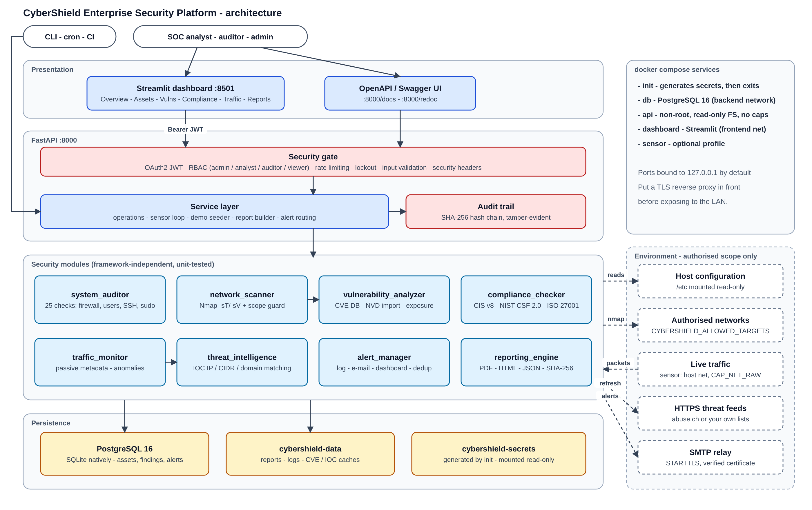
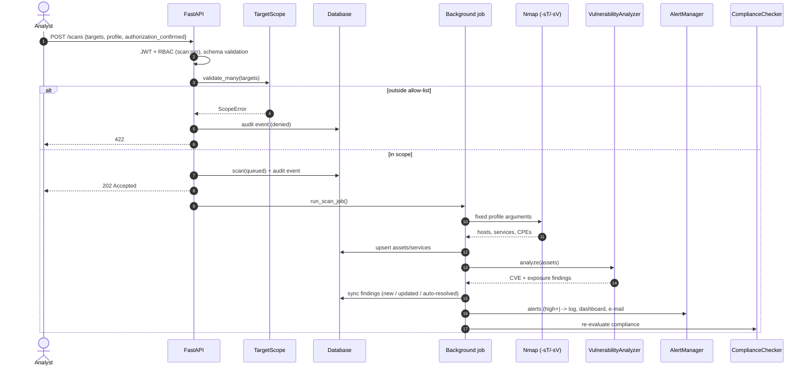
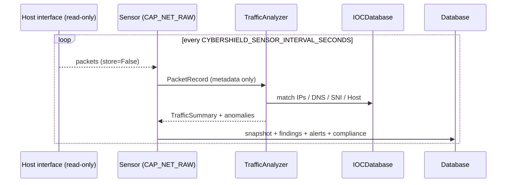

# Architecture

([SVG version](images/architecture.svg))

## 1. Design principles

1. **Defensive and authorised by construction** - scanning is impossible outside an allow-list; raw Nmap
   arguments are never accepted; the traffic monitor is passive and keeps metadata only; host checks are read-only.
2. **Modules are framework-independent** - each security module is plain Python with typed inputs/outputs
   (pydantic), unit-tested in isolation. FastAPI, the CLI and the sensor are thin adapters over a shared service layer.
3. **Secure by default** - non-root containers, read-only root filesystems, all capabilities dropped, secrets
   generated at first boot, ports bound to localhost, deny-by-default RBAC, tamper-evident audit trail.
4. **Explainable results** - every finding carries evidence, a recommendation, references and a confidence level;
   scores are simple published formulas.
5. **Zero-config deployment** - `docker compose up -d` works without editing any file.

## 2. Components

| Layer | Package | Responsibility |
|---|---|---|
| Presentation | `app/dashboard` | Streamlit SOC dashboard; calls the API with the user's token (no direct DB access) |
| API | `app/api` | FastAPI routers, schemas (strict validation), dependencies (auth, RBAC) |
| Core | `app/core` | config, JWT/Argon2id, RBAC, rate limiting, middleware, scope guard, audit trail, logging |
| Services | `app/services` | orchestration: run module → persist → alert → re-evaluate compliance; sensor; demo; secrets |
| Persistence | `app/database` | SQLAlchemy 2 models, repository helpers, schema bootstrap |
| Modules | `app/modules/*` | the eight security engines (below) |
| Interfaces | `app/cli.py`, `app/main.py` | CLI and ASGI application factory |

### Security modules

| Module | Input → Output | Highlights |
|---|---|---|
| `system_auditor` | host root (live `/` or mounted `/host`) → `HostAuditReport` | 25 registered checks; pure functions over an `AuditContext` (filesystem root + command runner) so they run live, from a container, or against fixtures; permission errors become `unknown`, never crashes |
| `network_scanner` | targets + profile → `NetworkScanResult` | `TargetScope` validation (allow-list, size cap, no option injection, hostname resolved once), fixed profiles, python-nmap parsing |
| `vulnerability_analyzer` | discovered services → `VulnerabilityReport` | CPE/banner identification, tolerant version comparison (`8.9p1`, `1.0.1f`, `9.0.0.M1`), NVD JSON 2.0 import, exposure rules, distro back-port confidence, patch/hardening/best-practice recommendations |
| `traffic_monitor` | scapy packets / PCAP → `TrafficSummary` | streaming, bounded memory; protocol mix, talkers, DNS/HTTP/TLS metadata, trends, 11 anomaly detectors, health score |
| `threat_intelligence` | IOC files / HTTPS feeds → `IOCDatabase` | IPs, CIDRs, domains (parent-domain matching), validated feed ingestion |
| `compliance_checker` | check statuses + findings → `ComplianceReport` | YAML control catalogue (33 controls, 3 frameworks), weighted scoring, gap analysis with priorities, 5×5 risk matrix, executive summary |
| `alert_manager` | findings / scores → channels | severity routing per channel, fingerprint de-duplication with DB-backed cooldown, isolated channel failures |
| `reporting_engine` | `ReportData` → PDF / HTML / JSON | 4 report types, ReportLab PDF, auto-escaped Jinja2 HTML, SHA-256 per file, path-traversal-safe storage |

## 3. Main flows

### Authorised network scan

### Passive sensor window

## 4. Data model

| Table | Purpose | Notes |
|---|---|---|
| `users` | accounts | Argon2id hash, role, lockout counters |
| `revoked_tokens` | logout / password change | pruned when expired |
| `audit_events` | who did what, when, from where | `hash = SHA-256(prev_hash ‖ canonical JSON)` |
| `assets`, `services` | inventory | unique IP, unique (asset, port, protocol) |
| `scans` | every operation (network, host_audit, compliance) | full module output in `summary` (JSON) |
| `findings` | current state per unique finding | upsert by fingerprint (source, asset, id, port); auto-resolve / re-open |
| `alerts` | dashboard channel | fingerprint + cooldown de-duplication |
| `compliance_results` | score history per framework | trend charts |
| `traffic_snapshots` | one row per capture / sensor window | summary JSON |
| `reports` | generated files | filename, SHA-256, size, author |

All timestamps are stored as UTC (`UTCDateTime` type) and returned timezone-aware, identical on SQLite and PostgreSQL.
`is_demo` flags (and the `demo` asset tag) isolate the demo dataset.

## 5. Deployment topology

| Service | Image | Network | Privileges | Volumes |
|---|---|---|---|---|
| `init` | cybershield | none | root, CHOWN/FOWNER/DAC_OVERRIDE only, exits | secrets (rw) |
| `db` | postgres:16-alpine | backend (+ 127.0.0.1:55432) | default | pg-data, secrets (ro) |
| `api` | cybershield | backend + frontend | uid 10001, read-only FS, no capabilities | data, secrets (ro), host `/etc` (ro) |
| `dashboard` | cybershield | frontend | uid 10001, read-only FS, no capabilities | - |
| `sensor` (profile) | cybershield | host | root with NET_RAW + NET_ADMIN only, read-only FS | data, secrets (ro) |

Secrets: `jwt_secret` and `admin_password` (owner 10001, `0400`), `db_password` (root:10001, `0440`). The PostgreSQL
entrypoint reads its password file as root before dropping privileges; the application reads all three through
`*_FILE` variables so they never appear in `docker inspect`.

## 6. Scalability and limits

* The API runs one Uvicorn worker by default (`WEB_CONCURRENCY`); the in-process rate limiter and background
  scans are per process. For horizontal scaling put rate limiting in the reverse proxy and move scans to a queue
  (the service layer is already decoupled: `execute_network_scan()` is a plain function).
* Traffic analysis is streaming with bounded counters (`CYBERSHIELD_TRAFFIC_MAX_PACKETS`, capped tracking sets).
* SQLite is fine for a single analyst workstation; use PostgreSQL (default in Docker) for teams.
* Schema migrations: the schema is created with `create_all`; for long-lived deployments add Alembic migrations
  before changing models.
