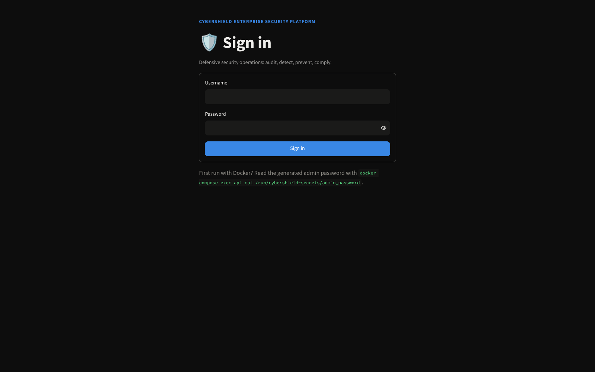
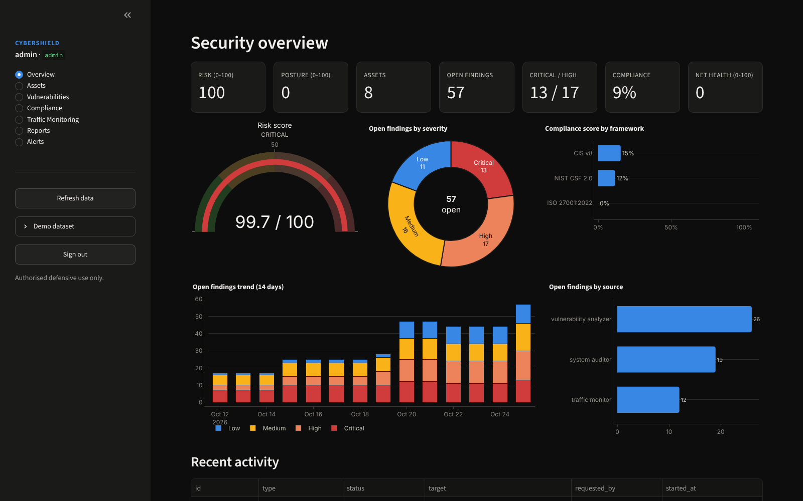
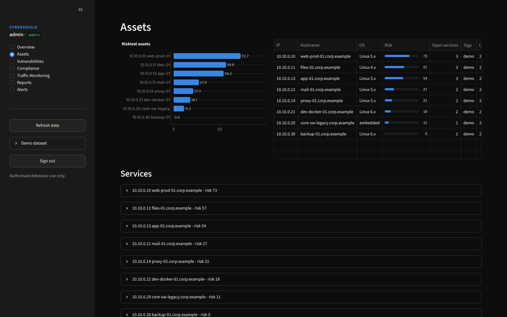
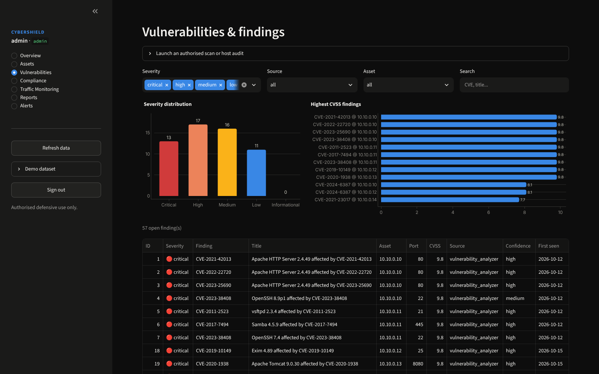
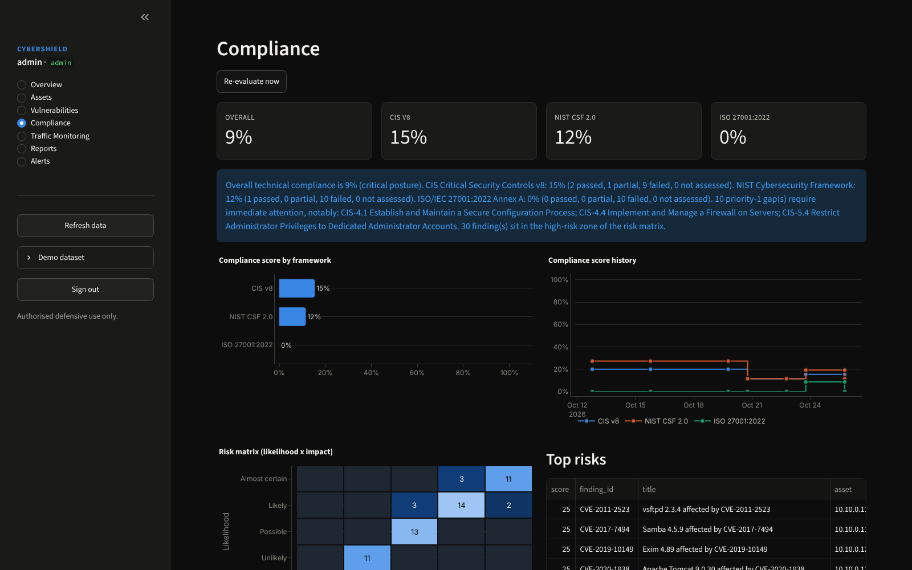
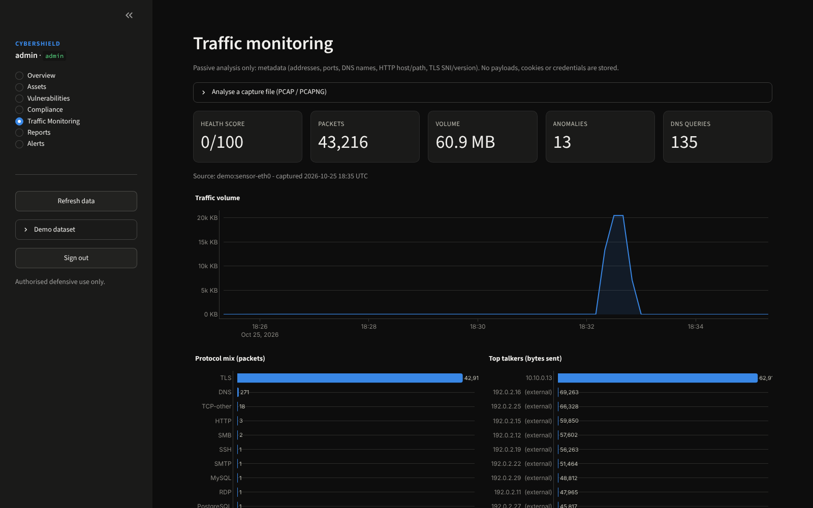
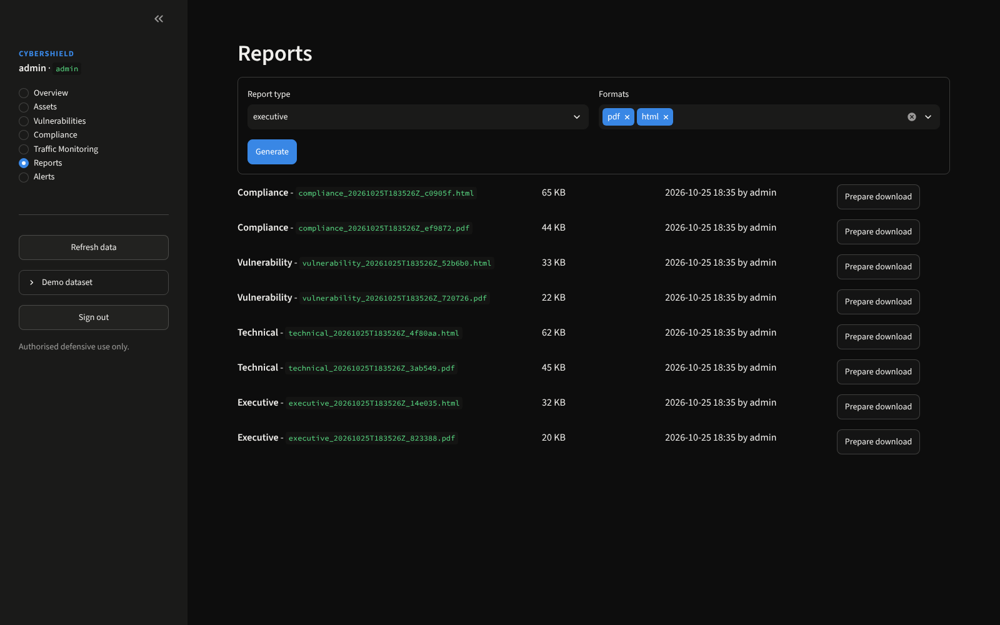
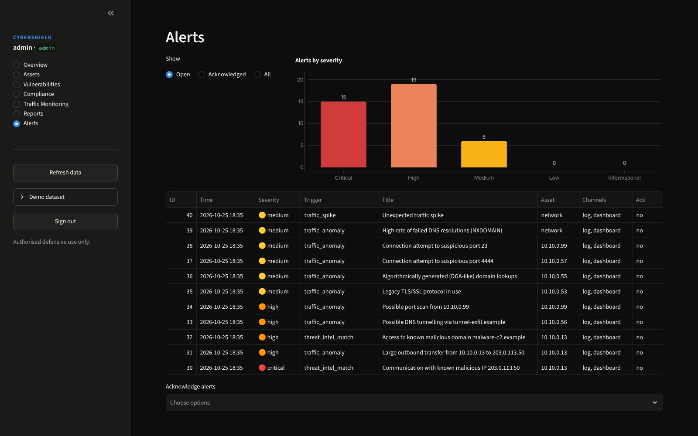

# User Guide

## 1. Roles

Accounts are created by an administrator (`POST /api/v1/users` or `cybershield create-user`). Permissions are
deny-by-default and enforced by the API, so the dashboard shows only the actions your role allows.

| Capability | viewer | auditor | analyst | admin |
|---|:-:|:-:|:-:|:-:|
| View dashboard, assets, findings, traffic, compliance, alerts, reports | ✅ | ✅ | ✅ | ✅ |
| Generate reports | | ✅ | ✅ | ✅ |
| Read the audit trail | | ✅ | | ✅ |
| Threat-intel lookups | | ✅ | ✅ | ✅ |
| Run host audits, network scans, PCAP analysis, compliance evaluation | | | ✅ | ✅ |
| Triage findings, acknowledge alerts | | | ✅ | ✅ |
| Manage users, refresh threat feeds, demo dataset | | | | ✅ |

Passwords: at least 12 characters with upper/lower case, digit and symbol, not containing the username. Five
failed logins lock the account for 15 minutes. Sessions expire after 30 minutes; **Sign out** revokes the token.

## 2. Dashboard tour



### Overview
Risk score (0 = no open risk, 100 = saturated), security posture, asset and finding counts, overall compliance and
network health; risk gauge, open findings by severity, compliance per framework, 14-day trend and recent activity.



### Assets
Every host discovered by authorised scans, ranked by risk score, with open services (port, product, version).



### Vulnerabilities
* **Launch an authorised scan or host audit** (analyst+): enter IPs/CIDRs/hostnames inside the allowed scope, choose
  a profile and tick the authorisation box.
* Filter by severity, source, asset or text; the table is sorted by severity then CVSS.
* **Finding details** shows description, evidence, recommendation and references, and lets analysts set the status:
  `resolved`, `accepted_risk`, `false_positive` or back to `open` (with a comment kept in the audit trail).



### Compliance
Scores for CIS Controls v8, NIST CSF 2.0 and ISO/IEC 27001:2022, score history, the likelihood × impact risk
matrix, top risks, per-control status with evidence, gap analysis and prioritised recommendations.
**Re-evaluate now** recomputes everything from the latest audit, scan and traffic data.



### Traffic Monitoring
Upload a PCAP/PCAPNG (analyst+) or run the sensor. Shows health score, volume trend, protocol mix, top talkers,
anomalies, DNS domains, TLS versions/SNI and cleartext HTTP hosts. Only metadata is processed: no payloads,
cookies, credentials or query strings are kept.



### Reports
Generate executive, technical, vulnerability or compliance reports in PDF, HTML and JSON; download any previous
report (SHA-256 shown in the API for integrity checks).



### Alerts
Alerts raised by the platform (unsafe configuration, vulnerability discovered, traffic anomaly / spike,
threat-intel match, compliance failure), with the channels used. Analysts acknowledge them in bulk.



## 3. Typical workflows

### 3.1 Baseline a new environment
1. `admin` creates named accounts and changes the generated password.
2. Set `CYBERSHIELD_ALLOWED_TARGETS` to the authorised ranges.
3. Run a host audit, then a `standard` scan of each subnet.
4. Start the sensor (or upload a representative PCAP).
5. Review **Compliance → Gap analysis**, fix P1 items first, generate the executive report for management.

### 3.2 Continuous monitoring
* Sensor running permanently (`docker compose --profile sensor up -d sensor`).
* Weekly scans (cron / CI calling the API or CLI), daily host audits (`scripts/run_audit.sh`).
* E-mail alerts for `high` and above (`CYBERSHIELD_ALERT_EMAIL_MIN_SEVERITY`).
* Alerts are de-duplicated for `CYBERSHIELD_ALERT_COOLDOWN_MINUTES` (default 60).

### 3.3 Remediation tracking
Findings are **upserted**: a new scan updates `last_seen`; when a finding disappears from a later run of the same
module on the same asset it is automatically marked `resolved`; if it comes back it is re-opened. The trend chart
therefore shows real progress.

### 3.4 CI security gate
```bash
cybershield audit host --no-save --json audit.json --fail-on high   # exit code 2 if high+ findings
```

## 4. Understanding the scores

| Score | Meaning | Formula |
|---|---|---|
| **Risk score** (0-100) | Aggregated open risk | `100 × (1 − e^(−Σw/50))`, w = 10 critical, 6 high, 3 medium, 1 low |
| **Security posture** | Inverse of risk | `100 − risk` |
| **Hardening score** | Host audit result | weighted pass ratio of evaluated checks (warn = half) |
| **Compliance score** | Per framework | weighted controls: pass 1, partial 0.5, fail 0; not-assessed controls excluded |
| **Network health** | Latest capture | `100 −` 25 per critical, 12 per high, 5 per medium, 2 per low anomaly |

Severity follows CVSS v3 bands (critical ≥ 9.0, high ≥ 7.0, medium ≥ 4.0, low > 0). Remediation targets used in
reports:

| Priority | Severity | Target |
|---|---|---|
| P1 Immediate | critical | 24-72 hours |
| P2 Urgent | high | 7 days |
| P3 Planned | medium | 30 days |
| P4 Routine | low | 90 days |

**Confidence:** CVE matches on distribution packages (Ubuntu/Debian/RHEL banners) are marked `medium` confidence:
vendors backport fixes without changing the upstream version, so confirm with the distribution security tracker.

## 5. CLI reference

```text
cybershield init-db                                  create schema + first admin
cybershield create-user --username U --email E --role analyst [--password-stdin]
cybershield audit host [--host-root /] [--json F] [--pdf F] [--html F] [--no-save] [--fail-on high]
cybershield scan network TARGET... [--profile discovery|quick|standard|full] --i-am-authorized [--json F]
cybershield traffic pcap FILE [--json F] [--no-save]
cybershield traffic capture [--iface eth0] [--duration 60] [--filter "not port 22"] [--json F]
cybershield sensor [--windows N]
cybershield compliance evaluate [--json F]
cybershield report generate --type executive|technical|vulnerability|compliance --format pdf html json
cybershield cve import nvd.json | cve lookup --vendor V --product P --version X
cybershield intel refresh | intel lookup INDICATOR
cybershield demo seed|purge
cybershield verify-audit-trail
cybershield secrets init --dir DIR
cybershield sample-pcap FILE
```

Exit codes: `0` success, `1` error/refused, `2` findings at or above `--fail-on` / audit trail tampered.

## 6. Scan profiles

| Profile | Nmap arguments (fixed, not user-editable) | Use |
|---|---|---|
| `discovery` | `-sn -T3` | which hosts are up |
| `quick` | `-sT -T3 --top-ports 100 --open` | fast exposure check |
| `standard` | `-sT -sV --version-intensity 5 -T3 --top-ports 1000 --open` | inventory + CVE correlation (default) |
| `full` | `-sT -sV --version-intensity 7 -T3 -p- --open` | all TCP ports (slow) |

All profiles add `--host-timeout` and never run NSE exploitation scripts, evasion or aggressive timing.

## 7. Importing the full NVD database

The bundled CVE file is a curated offline subset. Download NVD CVE JSON 2.0 data (API or yearly feeds) and import:

```bash
cybershield cve import nvdcve-2.0-2024.json
docker compose exec api cybershield cve import /var/lib/cybershield/data/nvdcve-2.0-2024.json   # Docker
```

Imported records are merged into `<data_dir>/cve_db.json` and used by every subsequent scan.

## 8. FAQ

**Can CyberShield scan the Internet?** Only if an administrator adds those ranges to
`CYBERSHIELD_ALLOWED_TARGETS`. Never add ranges you are not authorised to test.

**Does the sensor decrypt TLS or capture passwords?** No. It reads TLS ClientHello metadata (SNI, version) only and
never stores payloads.

**Is the demo data mixed with mine?** It is flagged (`is_demo`, asset tag `demo`) and removed with
**Purge demo data** / `cybershield demo purge`, leaving your own results untouched.

**How do I remove CyberShield?** `./scripts/uninstall.sh --dry-run` shows what would be deleted, then
`./scripts/uninstall.sh` removes the Docker and/or native installation (add `--keep-data` to keep the database,
reports and logs). See [Installation → Uninstall](INSTALLATION.md#6-uninstall).
